---

## 📌 Tentang

S I E menjalankan bot trading di akun Deriv member yang sudah terverifikasi. Bot bekerja memakai token API dengan **scope trade saja**, sehingga dana tetap berada di akunmu dan tidak bisa ditarik atau dipindahkan.

Layanan ini gratis untuk member di bawah S I E Partner.

## 📊 Pilihan seri

Versi teks

- **Starter**: modal $7 – tanpa batas, target +100% dari modal awal, batas rugi hingga 100% modal
- **Advanced**: modal $500 – $4.000, target +5% dari modal awal, batas rugi maks. 50% modal
- **Expert**: modal $5.000 – $10.000, target +5% dari modal awal, batas rugi maks. 25% modal

Satu siklus belum tentu mencapai target. Target bukan jaminan profit.

## 🚀 Cara bergabung

Langkah lengkap

1. Buka akun Deriv lewat tombol **Open Account** di website.
2. Buat token API dengan scope **trade** saja, tanpa scope payment.
3. Isi form **Verifikasi** di website, pilih seri sesuai modal, lalu simpan kode member.
4. Tunggu verifikasi. Status berjalan dari menunggu, disetujui, lalu live.
5. Pantau performa di dashboard website dan posisi di akun Deriv kamu.

Kamu bisa menghentikan bot kapan saja lewat tombol **Stop** di website, atau dengan mencabut token di Deriv.

## 🔒 Komitmen keamanan

✅ Token hanya dengan scope **trade**. Token yang punya scope payment ditolak. 
✅ Token dienkripsi di browser sebelum dikirim. 
✅ Dana tidak pernah berpindah dari akunmu.

> [!IMPORTANT]
> **Admin S I E tidak pernah meminta token atau password lewat chat.** Jangan berikan ke siapa pun.

## ⚠️ Peringatan risiko

> [!WARNING]
> Trading derivatif mengandung risiko tinggi dan bisa menyebabkan kerugian, termasuk seluruh modal. Performa masa lalu tidak menjamin hasil di masa depan. Gunakan hanya dana yang siap kamu tanggung risikonya.

## 💬 Kontak

Pertanyaan umum ada di bagian **Informasi** pada website.

---

© S I E · Dikembangkan oleh Nana Lafea. Seluruh hak dilindungi.

